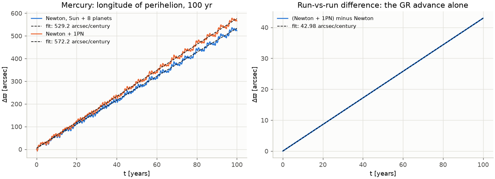
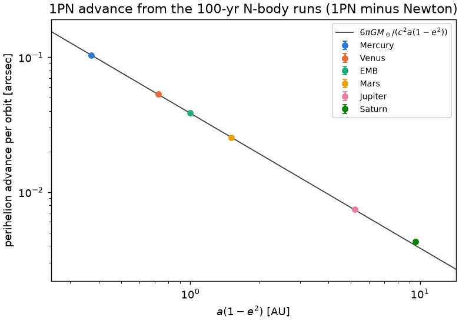
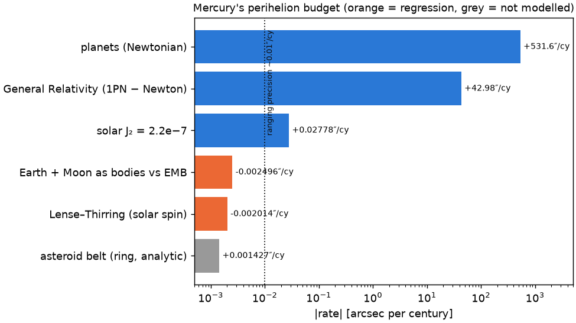

# gravsim — Newton vs. Einstein in the solar system

A pedagogical Python package (guided project, undergraduate level) that integrates the solar
system first with Newtonian gravity and then with General Relativity, and makes the difference
*measurable*: Le Verrier's unexplained 43 arcseconds per century of Mercury's perihelion
advance come out of the simulation itself.

The package implements its own force laws (Newton, 1PN test-particle correction, the full
Einstein–Infeld–Hoffmann N-body equations, both PPN-parametrised with β, γ, plus the solar
quadrupole J₂ and Lense–Thirring frame dragging that compete with GR), its own integrators
(Euler, symplectic Euler, Leapfrog, RK4, Yoshida 4/6, plus a `solve_ivp`/DOP853 wrapper for
production runs), exact Schwarzschild geodesics for massive bodies and for light (deflection,
capture, Shapiro delay), and a measurement toolkit (Kepler elements, Laplace–Runge–Lenz vector,
perihelion tracking, node and argument series, secular fits, run-vs-run differencing). JPL
Horizons data are used only as initial conditions and as an independent reference (including a
ten-year Earth + Moon series); REBOUNDx `gr_full` is an independent oracle for the EIH
equations. See `ROADMAP.md` for the physics plan and `CONTRIBUTING.md` for the engineering contract
(units, frames, API).



*Left: Mercury's osculating longitude of perihelion over a century in a Sun + 8 planet run,
with and without the 1PN term — the planetary wobble dominates. Right: the difference of the
two runs on the same time grid; the wobble and the numerical error cancel and the GR advance,
42.98″/century, remains.*

## Install

Python 3.12, managed with [uv](https://docs.astral.sh/uv/):

```bash
scripts/setup_env.sh            # uv venv + editable install with the dev extras
# or by hand:
uv venv .venv && uv pip install -e ".[dev]"
```

Everything runs through the venv: `.venv/bin/python ...`. Dependencies: numpy, scipy,
matplotlib, astropy, astroquery, numba (dev: pytest, ruff, jupyter, rebound/reboundx as
external oracles, httpx and playwright for the web tests; extras `app` = streamlit + plotly,
`web` = fastapi + uvicorn, `docs` = mkdocs-material). The cached ephemerides in `gravsim/data/`
make the package fully usable offline; `astroquery` is only needed to refresh them.

## Units and conventions

Length in AU, time in days, masses as **GM in AU³/day²**; the speed of light is always an
explicit parameter (`c=constants.C_AU_DAY`) so lessons can scale it down. Frame: solar-system
barycentre, J2000 ecliptic; `t` is days since J2000.0 TDB. Default system: Sun + 8 planets
(Earth = Earth–Moon barycentre, outer planets = system barycentres); `load_j2000(with_moon=True)`
gives Earth and Moon as separate bodies. Angles in radians inside, precession rates reported in
arcsec per Julian century.

## Layout

```
gravsim/
  constants.py        GM values (DE440), c, unit conversions, reference numbers
  bodies.py           SystemState (one instant) and Trajectory (time series)
  forces/             newton.py (numba kernel + numpy fallback), pn1.py (1PN, PPN β γ),
                      eih.py (Einstein–Infeld–Hoffmann N-body 1PN, PPN β γ), combine(),
                      extras.py (solar J₂ quadrupole, Lense–Thirring frame dragging)
  integrators/        fixed_step.py (Euler … Yoshida6), driver.py, scipy_wrap.py (DOP853)
  analysis/           kepler.py, elements.py, precession.py (ϖ and element series, fits),
                      conserved.py, compare.py
  metric/             schwarzschild.py (effective potential, Binet orbit, geodesics, ISCO),
                      null.py (photon geodesics: deflection, capture, ray paths, Shapiro delay)
  data/               horizons.py + j2000.json / j2000_moon.json (snapshots) +
                      horizons_ref.npz (100-yr series) + horizons_moon_ref.npz (10-yr Earth + Moon)
  viz/                plots.py (matplotlib, 3-D orbits, measurement plots), interactive.py (plotly)
  web/                scenarios.py (the five web scenarios, pure), payload.py (binary format),
                      server.py (FastAPI), __main__.py (the gravsim-web command)
web/                  index.html, app.js, style.css: the Three.js front end (no build step)
notebooks/            lessons 01–09 (physics first, then code; ~2.5 min total)
app/                  streamlit_app.py (seven interactive labs, 3-D) + labs.py, lab_ppn.py,
                      lab_light.py, lab_extras.py (their pure back ends)
docs/                 mkdocs pages: theory with derivations, lesson index, app, web, validation
scripts/
  validate.py         end-to-end physics validation, prints a table and saves figures/
  export_web.py       static export of the web scenarios (manifest.json + <id>.bin)
  fetch_j2000.py      refresh the cached ephemerides (network); fetch_moon.py the Earth + Moon ones
tests/                one test_<module>.py per package module, test_validation.py (ROADMAP §4),
                      test_app.py, test_notebooks.py, test_web_backend.py, test_web.py (browser)
figures/              output of scripts/validate.py and of the browser tests (web_<id>.png)
```

A minimal run:

```python
import numpy as np
from gravsim.data.horizons import load_j2000
from gravsim.forces import accel_newton, make_newton_pn1
from gravsim.integrators import integrate_scipy
from gravsim.analysis import perihelion_rate_difference

state = load_j2000()                                   # Sun + 8 planets at J2000.0
t_eval = np.arange(0.0, 36526.0, 1.0)                  # one Julian century, daily samples
newton = integrate_scipy(state, accel_newton, t_eval)  # DOP853, rtol 1e-12, atol 1e-15
gr = integrate_scipy(state, make_newton_pn1(central=state.index("Sun")), t_eval)
rate, err = perihelion_rate_difference(gr, newton, "Mercury")   # -> 42.98 ± 0.001 "/cy
```

## Tests and validation

```bash
.venv/bin/python -m pytest -q                 # fast suite, ~2 min (slow, network and web tests deselected)
.venv/bin/python -m pytest -q -m slow         # century-long validation runs + notebook execution, ~6 min
.venv/bin/python -m pytest -q -m web          # browser tests of the Three.js front end (playwright + chromium)
.venv/bin/python -m pytest -q -m network      # one live Horizons query against the cache
.venv/bin/ruff check gravsim tests scripts app
.venv/bin/python scripts/validate.py          # all checks below + figures/, ~2.5 min
.venv/bin/python scripts/validate.py --years 10 --figures /tmp/quick   # quick look
```

`tests/test_validation.py` contains the same checks as `scripts/validate.py`: fast variants
over ten years (or 50 orbits, or two years for the Moon) where the signal is already
measurable, century-long variants marked `@pytest.mark.slow`. Every package module has its own
`tests/test_<module>.py` (analytic references wherever possible; `test_eih.py`, `test_null.py`,
`test_extras.py` and `test_moon.py` cover Phases 5–8; `test_web_backend.py` the scenario
builder, payload format, FastAPI app and export script); `tests/test_notebooks.py` checks the
lessons' structure and, under `slow`, executes them; `tests/test_app.py`, `test_lab_ppn.py`,
`test_lab_light.py` and `test_lab_extras.py` test the lab back ends and run the Streamlit app
headlessly, lab by lab; `tests/test_web.py` (marker `web`) drives the front end in headless
Chromium. No test touches the network unless asked to with `-m network` (the browser tests
fetch three.js from its CDN).

## Validation results

Produced by `.venv/bin/python scripts/validate.py` (100-year runs, DOP853 with rtol 1e-12,
atol 1e-15, samples every day; Sun + Mercury runs start from the J2000 snapshot moved to their
own barycentre; "fit" = least-squares slope of the osculating longitude of perihelion;
"passages" = the same from perihelion passages only). All 64 checks pass.

| # | Check | Value | Expected | Tolerance |
|---|---|---|---|---|
| 1 | 2-body Newton, Mercury, 100 yr, DOP853: fitted rate (noise floor) | 0.0012 ″/cy | 0 | 0.5 |
| 1 | … from perihelion passages | 0.0012 ″/cy | 0 | 0.5 |
| 1 | Leapfrog, dt = 0.5 d, 10 yr: spurious precession | −196 972 ″/cy | — | report |
| 1 | Yoshida4, dt = 0.5 d, 10 yr: spurious precession | 2 634 ″/cy | — | report |
| 2 | 2-body (Newton + 1PN) minus Newton, Mercury, 100 yr | 42.9805 ″/cy | 42.98 | 0.10 |
| 2 | 2-body Newton + 1PN, undifferenced fit | 42.9817 ″/cy | 42.98 | 0.10 |
| 2 | analytic 6πGM/(c²a(1−e²)) for Mercury's osculating a, e | 42.9807 ″/cy | 42.98 | 0.10 |
| 2 | fit minus analytic | −0.0002 ″/cy | 0 | 0.10 |
| 3 | Schwarzschild exact (Binet orbit), Mercury | 42.9808 ″/cy | 42.98 | 0.10 |
| 3 | Schwarzschild exact minus 1PN formula | 1.0e−4 ″/cy | 0 | 0.01 |
| 4 | c/100, 50 orbits: fitted rate / analytic (same c) | 0.9981 | 1 | 0.01 |
| 4 | … differenced against Newton / analytic | 0.9981 | 1 | 0.01 |
| 4 | … from perihelion passages / analytic | 0.9985 | 1 | 0.01 |
| 5 | N-body Newton, Mercury, 100 yr: fit | 529.2 ″/cy | 531.6 | 3 |
| 5 | … from perihelion passages | 529.3 ″/cy | 531.6 | 3 |
| 6 | N-body Newton + 1PN, Mercury: fit | 572.2 ″/cy | 574.6 | 3 |
| 6 | … from perihelion passages | 572.2 ″/cy | 574.6 | 3 |
| 6 | N-body (Newton + 1PN) minus Newton, Mercury | 42.977 ″/cy | 42.98 | 0.10 |
| 6 | … Venus | 8.637 ″/cy | 8.62 | 0.10 |
| 6 | … Earth–Moon barycentre | 3.851 ″/cy | 3.84 | 0.10 |
| 6 | … Mars | 1.351 ″/cy | 1.35 | 0.10 |
| 7 | Horizons series (20-day samples, 100 yr), Mercury: fit | 572.2 ″/cy | 574.1 | 5 |
| 7 | … from perihelion passages | 572.3 ″/cy | 574.1 | 5 |
| 7 | Newton run vs Horizons, Mercury: mean / final separation | 5 162 / 5 743 km | — | report |
| 7 | Newton + 1PN run vs Horizons, Mercury: mean / final separation | 72 / 176 km | — | report |
| 7 | final separation ratio 1PN / Newton | 0.031 | < 1 | — |
| 8 | relative energy error, N-body DOP853, 100 yr | 6.8e−14 | 0 | 1e−9 |
| 8 | relative energy error, N-body Yoshida4, dt = 0.5 d, 10 yr | 2.2e−9 | 0 | 1e−8 |
| 9 | light deflection at the solar limb, 4GM/(c²R☉) | 1.7512″ | 1.751 | 0.001 |
| 10 | N-body EIH (every body relativistic), Mercury, 100 yr: fit | 572.2 ″/cy | 574.6 | 3 |
| 10 | N-body EIH minus Newton: Mercury / Venus / EMB / Mars | 42.977 / 8.637 / 3.851 / 1.351 ″/cy | 42.98 / 8.62 / 3.84 / 1.35 | 0.10 |
| 11 | N-body EIH minus (Newton + 1PN), Mercury: secular difference | 1.5e−5 ″/cy | 0 | 0.02 |
| 11 | … maximum separation of the two GR runs, 100 yr | 5.1 km | — | report |
| 12 | REBOUNDx `gr_full` (IAS15) vs EIH run, Sun + 8 planets, 10 yr: max over all bodies | 0.035 km | 0 | 10 |
| 13 | PPN two-body, 10 yr: fit / [(2+2γ−β)/3 × 42.98] for (β,γ) = (1,1) / (0,1) / (1,0) / (2,1) | 1.0002 / 1.0001 / 1.0003 / 1.0004 | 1 | 0.01 |
| 14 | light deflection at the limb, exact null geodesic | 1.7512″ | 1.751 | 0.001 |
| 14 | … Soldner's Newtonian corpuscle, 2GM/(c²R☉) | 0.8756″ | 0.8755 | 0.001 |
| 15 | Shapiro delay, Earth (1 AU) → Mars (1.524 AU) grazing the Sun, one way | 123.6 μs | ~124 | report |
| 15 | … exact null geodesic / weak-field formula | 1.0001 | 1 | 0.01 |
| 16 | Sun + Mercury + solar J₂ (2.2·10⁻⁷) minus Newton, 100 yr | +0.0278 ″/cy | 0.028 | 0.005 |
| 16 | J₂ × 1000, 10 yr: node Ω and argument ω rates over Kaula's formulas (solar-equator frame) | 1.0000 / 0.9999 | 1 | 0.03 |
| 17 | J × 10⁵, 10 yr: node and argument rates over the Lense–Thirring formulas | 1.0000 / 1.0000 | 1 | 0.03 |
| 17 | Sun + Mercury + Lense–Thirring (real solar spin) minus Newton, 100 yr | −0.0020 ″/cy | ~−0.002 | report |
| 18 | Moon (Sun + planets + Earth + Moon, 10 yr): sidereal month | 27.3217 d | 27.3217 | 0.05 |
| 18 | … perigee / node rates | +40.59 / −19.36 °/yr | 40.69 / −19.34 | 1.5 / 1.0 |
| 18 | … minus the same fits of the Horizons series over the same span | −0.002 / +0.007 °/yr | 0 | 0.3 |
| 18 | Moon vs Horizons, max separation over 2 yr, Newton + 1PN / Newton | 37.6 / 157 km | 0 / — | 500 / report |
| 18 | real Earth–Moon barycentre vs Horizons, max over 10 yr | 6.8 km | — | report |
| 18 | EMB point-mass run vs the real barycentre after 10 yr | 1170 km | 2εnat = 1101 | report |
| 18 | Mercury (1PN − Newton) with Earth + Moon minus the EMB value | 6·10⁻⁸ ″/cy | 0 | 0.1 |
| 18 | Mercury's Newtonian rate, Earth + Moon minus EMB | −0.0025 ″/cy | ~−0.0025 | report |

Notes on the numbers:

* The absolute N-body rates (529.2 Newton, 572.2 with 1PN) sit 2.4″/cy below the textbook
  531.6 / 574.6. That is not a force-law error: the Horizons series itself, fitted over the same
  100 years by the same method, gives 572.2 rather than the 574.1 observed. An ordinary
  least-squares slope of the osculating series over one century is biased by the long-period
  planetary terms (the Jupiter–Saturn and Venus–Earth terms do not average out over 100
  years), and the missing Moon, asteroids and Pluto contribute ~0.1″/cy. The *differences*
  between runs on the same grid are free of this bias, which is why every GR assertion is
  differential: 42.977 ± 0.001 (N-body) and 42.9805 ± 0.001 (2-body) against 42.98.
* The DOP853 noise floor (0.0012″/cy) is four orders of magnitude below the GR signal; the
  fixed-step integrators at half-day steps are not (Leapfrog −2·10⁵, Yoshida4 +2.6·10³ ″/cy),
  which is the lesson of Phase 1: the GR term cannot be read off an integrator whose own
  precession is larger than 43″/cy.
* Horizons (DE441) contains GR, so the Newton run drifts away from it along the orbit by
  thousands of km per century while the 1PN run stays within ~200 km — Le Verrier's anomaly
  seen "from data" (`figures/mercury_vs_horizons.png`).
* The ROADMAP's "2-body vs Kepler < 1e-10 AU over 100 orbits (DOP853)" row is not attainable
  in double precision with this formulation (~4e-10 AU floor, ~3e-8 AU at the default
  tolerances; see `gravsim/integrators/scipy_wrap.py`); the noise-floor row above is the
  meaningful replacement and is what the suite asserts.
* The EIH equations (every body relativistic, as in the JPL ephemerides) and the Sun-only 1PN
  correction give the *same* secular rates to 1.5·10⁻⁵″/cy for Mercury: the Sun's barycentric
  motion (v☉/v☿ ≈ 4·10⁻⁴) and the planets' potentials (~10⁻⁴ of the Sun's) enter the 1PN term
  only periodically. The two runs differ by at most 5 km over a century; REBOUNDx `gr_full`,
  an independent implementation of the same equations, agrees with ours to 35 m over ten years.
* The PPN runs confirm that Mercury measures only the combination (2 + 2γ − β)/3: zero
  curvature (γ = 0) gives a third of the GR advance, β = 0 four thirds, β = 2 two thirds, each to
  a few parts in 10⁴ (`figures/ppn_precession_grid.png`).
* Light: the exact null geodesic grazing the Sun is bent by 1.7512″, above 4GM/(c²R☉) by the
  second-order (15π/16)GM/(c²R☉) ≈ 10⁻⁵ and exactly twice Soldner's 1801 corpuscle value. The
  Earth–Mars Shapiro delay at conjunction is 123.6 μs one way (247 μs for the Viking round trip);
  the exact-geodesic transit exceeds the weak-field formula by 10⁻⁴, the second-order end-point
  and Fermat terms discussed in `gravsim/metric/null.py`.
* The competing effects (Phase 8, Lesson 09): the oblate Sun advances Mercury's perihelion by
  +0.0278″/cy for J₂ = 2.2·10⁻⁷ — three times today's ranging precision and the only competitor
  that matters; frame dragging by the solar spin gives −0.0020″/cy; treating Earth and Moon as
  one body at their barycentre biases the Newtonian rate by −0.0025″/cy; an asteroid ring adds
  ~+0.0014. The three modelled terms sum to the +0.025″/cy residual of Lesson 06's Horizons − EIH
  comparison. The node and argument rates (which tell J₂ and frame dragging apart from GR, which
  moves only ω) match the Kaula and Lense–Thirring formulas to 10⁻⁴ with the effects amplified
  (`figures/lense_thirring_amplified.png`).
* The Moon: the ten-body run reproduces the sidereal month and the largest precessions in the
  solar system — the perigee advancing 40.6°/yr and the node regressing 19.4°/yr, purely
  Newtonian (the Sun's tide) — and agrees with the Horizons series fitted over the same span to
  0.01°/yr; the Moon stays within 38 km of Horizons over two years (161 km over ten) with the
  1PN term. The EMB point mass is not exactly where the real barycentre is: the pair feels on
  average ε = (3/4)w_E w_M (a_M/a_E)² ≈ 6·10⁻⁸ more solar pull than a point mass, so the EMB
  run lags the real barycentre by 2εnat ≈ 110 km/yr, while the split run's barycentre matches
  Horizons to 7 km over ten years. Mercury's GR signal does not notice any of this (6·10⁻⁸″/cy).

Headline figures (all produced by the script):

| | |
|---|---|
| `figures/mercury_perihelion_newton_vs_gr.png` | ϖ(t) of Mercury, Newton vs Newton + 1PN, and their difference |
| `figures/exaggerated_c_rosette.png` | Mercury with c/100: the ellipse visibly turns (0.29°/orbit), fit vs analytic |
| `figures/solar_system_3d.png` | the 100-year Newton run in 3-D, all planets and the inner four |
| `figures/energy_error.png` | relative energy error of DOP853 (100 yr) and Yoshida4 (10 yr) |
| `figures/precession_vs_a.png` | 1PN advance per orbit of each planet vs a(1−e²), with the 6πGM/(c²a(1−e²)) line |
| `figures/mercury_vs_horizons.png` | distance of the Newton and 1PN runs from the Horizons ephemeris |
| `figures/eih_vs_horizons.png` | Mercury's distance from Horizons for Newton, Newton + 1PN and EIH on one plot; EIH − 1PN in km |
| `figures/ppn_precession_grid.png` | Mercury's differenced ϖ(t) under the PPN-EIH law for (β,γ) = (1,1), (0,1), (1,0), (2,1), fit vs (2+2γ−β)/3 |
| `figures/light_bending_rays.png` | a bundle of rays past the Sun (deviation × 10⁴) and deflection vs impact parameter with the 1919 and VLBI points |
| `figures/precession_budget.png` | Mercury's perihelion budget on a log scale: planets, GR, solar J₂, Earth + Moon vs EMB, Lense–Thirring, asteroid ring |
| `figures/moon_orbit.png` | the Moon about the Earth in 3-D with its perigees marked (the line of apsides turning 40.6°/yr) and the fitted perigee and node longitudes |
| `figures/lense_thirring_amplified.png` | differenced node and argument of Mercury in the solar-equator frame for J × 10⁵ and J₂ × 1000 with the fits and the formulas |
| `figures/web_<id>.png` | screenshots of the five web scenarios (`solar_system`, `rosette`, `black_hole`, `light_rays`, `earth_moon`) taken by `tests/test_web.py` |





## Lessons, app and docs

The project is a guided undergraduate course: each phase ships a notebook *and* the matching
lab of the interactive app, and every lesson states the physics before the code.

| lesson (`notebooks/`) | app lab (`app/streamlit_app.py`) |
|---|---|
| 01 Why the integrator matters — order, symplecticity, spurious precession vs the 43″/cy signal | 1 · Integrator lab: method, step, energy error, spurious precession readout |
| 02 The clockwork solar system — N-body, the Sun's wobble in 3-D, planetary wobble of Mercury's perihelion, residuals vs Horizons | 2 · Solar system: Newton/GR toggle, c slider, amplified GR − Newton displacement in 3-D |
| 03 Measuring a drift of 0.1″ per orbit — eccentricity vector, three estimators, calibration on an oblate Sun | 3 · Precession tracker: live ϖ(t) of a planet in both runs, fitted and analytic rates |
| 04 Mercury's extra 43 arcseconds — the 1PN term, 42.98″/cy three ways, the c/100 rosette, PPN β γ | (labs 2 and 3 with c/100) |
| 05 Orbits around a black hole — effective potential, ISCO, exact vs 1PN, zoom-whirl, capture | 4 · Effective-potential explorer: drag L and E, see the geodesic |
| 06 Le Verrier, Vulcan, Einstein — the EIH equations, the anomaly reproduced *from the Horizons data* (43.02 ± 0.13″/cy for Newton, 0.02 for EIH), EIH vs Sun-only 1PN, mass-ratio independence of the advance | 5 · PPN playground (the GR corner of it: β = γ = 1) |
| 07 What if gravity were a different theory? — PPN β, γ, the (2+2γ−β)/3 factor on a 3×3 grid, the 2γ−β degeneracy, Brans–Dicke, Cassini/LLR/Mercury bounds | 5 · PPN playground: sliders for β, γ, c; fitted vs predicted rate; factor map; bounds chart |
| 08 Eddington 1919 — Soldner's 0.87″ vs Einstein's 1.75″, deflection vs b with the measurements, ray bundles, photon sphere and shadow, the Shapiro delay and spike | 6 · Light-bending lab: ray bundle, deflection curve, mass scale to capture, Shapiro delay at conjunction |
| 09 What else competes with GR? — the 0.01″ budget, the Moon as a body (sidereal month, perigee +40.6°/yr, node −19.4°/yr, the EMB drift), the oblate Sun (J₂ × 1000 and real vs Kaula), frame dragging (J × 10⁵ and real vs Lense–Thirring), what a century of ranging can tell apart | 7 · Competing effects: J₂ and frame-dragging toggles with amplification sliders, node and argument fits vs the formulas in the solar-equator frame, the Moon about the Earth, the budget chart |

```bash
.venv/bin/jupyter lab notebooks/                                   # the lessons (stored without outputs)
uv pip install -e ".[app]" && .venv/bin/streamlit run app/streamlit_app.py   # the lab (streamlit + plotly)
uv pip install -e ".[docs]" && .venv/bin/mkdocs serve                       # theory pages with derivations
```

## Web front end (Three.js)

`web/` is a browser viewer for five precomputed scenarios — the solar system under Newton and
GR with the GR − Newton displacement amplified until Mercury's perihelion advance is visible,
the c/100 rosette, a zoom-whirl Schwarzschild geodesic, a bundle of light rays past a compact
mass or the Sun, and the Earth–Moon system among the planets. The physics is computed in
Python (`gravsim/web/scenarios.py`) and shipped as float32 arrays; the browser only renders
(three.js 0.160.0 from a CDN through an import map, no build step).

```bash
uv pip install -e ".[web]"                                # fastapi + uvicorn
.venv/bin/gravsim-web --port 8000                         # API server; open http://127.0.0.1:8000/
.venv/bin/python scripts/export_web.py --out web/data     # or: static export (manifest.json + <id>.bin)
python -m http.server -d web 8000                         #     and serve web/ from anywhere
.venv/bin/python -m pytest -q -m web tests/test_web.py    # headless browser tests (figures/web_<id>.png)
```

The server builds scenarios on demand (`GET /api/scenario/<id>?years=10`, cached in memory)
and `GET /api/scenarios` lists them with their parameters; the static export writes the same
entries to `web/data/manifest.json` (git-ignored). See `web/README.md` and `docs/web.md`.

## Status

Phases 0–8 of the ROADMAP are implemented, validated and taught: foundations, Newton 2-body
and N-body, the measurement toolkit, 1PN + exact Schwarzschild (Lessons 01–05), the
Einstein–Infeld–Hoffmann N-body equations and the PPN playground (Phase 5, Lessons 06–07),
light as null geodesics (Phase 6, Lesson 08), the Streamlit app (Phase 7), and the competing
effects — solar J₂, Lense–Thirring frame dragging and the Moon as a body — with the Three.js
front end (Phase 8, Lesson 09, lab 7), each with its theory page. The asteroid belt is quoted
analytically (a ring gives +0.0014″/cy) and not integrated.

## Citing

See `CITATION.cff` (software citation, version 0.1.0).

## License

MIT.
